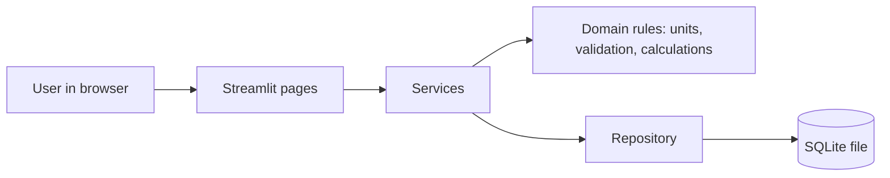

# Textile Resource Intelligence

A local application that records how much electricity, water, steam, fuel, chemicals and waste a textile unit uses, and relates that use to production.

## Overview

Textile Resource Intelligence helps a processing unit see how much resource it uses for each unit of production, for example kWh per kg of fabric. It keeps resource records and production records in one place, converts units, and calculates the ratio. When the data does not match, it says so and explains why instead of showing a misleading number.

It runs on one computer. Data is stored in a single local file. It needs no account, cloud service or paid software.

## Industrial Problem

Dyeing and processing units use a lot of electricity, water, steam, fuel and chemicals. The figures usually sit in different places: electricity bills, water meter readings, boiler logs, chemical stock sheets and production registers.

Total use is easy to read from these sources. A different question is harder to answer: is the unit using more or less resource for each kilogram it produces?

Some common situations:

- The electricity bill goes up. Did production go up, or did the machines become less efficient?
- Water use per kg looks lower this month. But production records for half the month are missing.
- One record is in MWh and another in kWh. One production figure is in kg and another in metres.
- The same entry is typed twice, and nobody notices.

Without matching periods, matching units and clean records, comparisons between months can be wrong.

## Proposed Solution

The application keeps resource use and production on the same time basis and compares them only when they match.

- You enter or import resource records and production records.
- The application converts units where a safe conversion exists.
- It divides total resource use by total production for the same period.
- It refuses to calculate when the data does not match, and shows the reason.
- It lists the records behind every result, so each number can be checked.

The application shows what the records say. It does not decide why a value changed, and it does not estimate savings.

## Key Capabilities

These features are implemented in version 0.1.0.

**Recording data**

- Resource records: quantity, unit, period, optional scope, reference and notes.
- Production records in kg, g, tonne, metres or pieces.
- Resource categories: Electricity, Water, Chemicals, Steam, Fuel, Waste and Other resources. You can add your own, for example one category per dye.
- Quantities and units are saved exactly as entered. Nothing is converted or rounded in storage.
- Edit and delete with confirmation. Results update automatically.

**Calculations**

- Resource totals per category and scope for a day, month or date range.
- Resource intensity: total resource divided by total production for the same period.
- Overall intensity across several periods: total resource divided by total production. It is not an average of monthly ratios.
- Comparison with a baseline period that you choose: difference and percentage change.
- Monthly or daily trend charts. Periods without valid data appear as gaps, not zeros.
- Unit conversion inside one type only: energy (kWh, MWh, MJ), volume (L, m³) and mass (kg, g, tonne).

**Data checks**

- Shows when records cover only part of a period.
- Shows when resource records and production records do not match.
- Flags possible duplicates, overlapping records, zero production and unknown units.
- Shows the record IDs behind each result.

**Import and export**

- CSV import with column matching, a preview, and a clear error list.
- CSV export of records and results.
- Backup of the database from the Settings page.

**Demonstration data**

- Optional sample data, always labelled as synthetic. It can be removed in one step.

## How It Works

1. **Input.** Enter records on the Resource Records and Production Records pages, or import a CSV file.
2. **Process.** The application checks each record, converts units, adds up the records for the selected period, and compares resource totals with production totals.
3. **Output.** The Overview and Analysis pages show totals, intensity, comparisons, trends and warnings. The Reports page exports them to CSV.

### Example

These numbers are made-up test values, not real measurements.

| Month | Electricity | Production | Intensity |
| --- | --- | --- | --- |
| January | 1,200 kWh | 600 kg | 2.0 kWh/kg |
| February | 900 kWh | 600 kg | 1.5 kWh/kg |

For February compared with January, intensity is 25% lower. Over both months the overall figure is 2,100 kWh ÷ 1,200 kg = 1.75 kWh/kg.

### Rules the application follows

- Different resources are never added together. Each chemical should be its own category.
- Production in kg, metres and pieces are never added together. You choose one as the basis.
- A record that crosses the edge of the selected period is not split. It is left out and flagged.
- Records that overlap with different dates could be counted twice, so the total is shown as unavailable until they are corrected.
- If resource records and production records cover different days of the period, intensity is unavailable.
- Missing data is never shown as zero. Zero production gives no intensity.
- Scope keys are names you choose, such as `dyeing-1`. Resource and production records are compared only when their scope keys are identical. Use a different scope key for each process stage so that material is not counted twice.
- Duplicates: the same reference, category, scope and period is rejected on manual entry and skipped on import. Records without a reference that look the same are kept and flagged. Nothing is deleted automatically.
- Import is all or nothing. If any row has an error, no row is saved.

## System Architecture

The user works in a web browser. Streamlit serves the pages from the same computer. The pages call services. The services use a set of rules for units, validation and calculations. Records are stored in one SQLite file.



- **Domain rules** (`domain/`) hold all calculation logic. They have no screen or database code, so they are easy to test.
- **Services** (`services/`) handle records, import, analysis, export and settings.
- **Pages** (`pages/`) only collect input and show results. They do not calculate.
- **Storage** is a local SQLite database. The database schema has a version number. The application refuses to open a database created by a newer version.

## Technology Stack

| Technology | Purpose |
| --- | --- |
| Python 3.12 | Main language |
| Streamlit | Web interface, run locally |
| SQLite with SQLAlchemy 2 | Local storage |
| pandas | Tables and CSV export |
| Plotly | Charts |
| Pydantic | Validation of application settings |
| pytest, Ruff | Testing and code checks (development only) |

Exact quantities use Python's `Decimal` type, so values such as 0.1 are stored without rounding error. All tools are free and open source.

## Installation & Setup

### Prerequisites

- Windows 10 or 11. Linux and macOS should also work, but the commands below are for Windows Command Prompt.
- Python 3.12. Download it from python.org and tick **Add python.exe to PATH**.
- Internet access once, to download the packages.

### Install

Open Command Prompt in the project folder and run:

```bat
py -3.12 -m venv .venv
.venv\Scripts\python.exe -m pip install --upgrade pip
.venv\Scripts\python.exe -m pip install -r requirements-dev.txt
```

`scripts\setup_windows.bat` runs the same steps.

The dependency list in `requirements.txt` uses version ranges, not exact versions. After a successful install and test run, you can save your exact versions with `.venv\Scripts\python.exe -m pip freeze > requirements.lock.txt`.

### Run

```bat
.venv\Scripts\python.exe -m streamlit run app.py
```

`scripts\run_app.bat` does the same. The browser opens at `http://localhost:8501`. If Streamlit asks for an email address in the terminal, press Enter. Stop the application with Ctrl+C.

The application listens on this computer only and sends no usage statistics. These settings are in `.streamlit/config.toml`.

### Test

```bat
.venv\Scripts\python.exe -m pytest
.venv\Scripts\python.exe -m ruff check .
```

Tests use synthetic data and temporary databases. They never touch your real database.

### Configuration

No configuration is needed to start. These optional environment variables are available:

| Variable | Purpose | Default |
| --- | --- | --- |
| `TRI_DATABASE_PATH` | Full path of the database file | `%LOCALAPPDATA%\TextileResourceIntelligence\textile_resource_intelligence.db` |
| `TRI_DATA_DIR` | Folder for the database, logs and backups | `%LOCALAPPDATA%\TextileResourceIntelligence` |
| `TRI_LOG_LEVEL` | `DEBUG`, `INFO`, `WARNING` or `ERROR` | `INFO` |
| `TRI_MAX_IMPORT_MB` | Largest CSV file accepted | 5 |
| `TRI_MAX_IMPORT_ROWS` | Most rows accepted in one CSV file | 50,000 |
| `TRI_PAGE_SIZE` | Rows per page in record tables | 50 |

## Usage

### First look with sample data

1. Start the application.
2. Open **Settings**, then **Demonstration data**, then load the synthetic data.
3. Open **Overview** and choose January 2025. The Resource intensity tab shows Electricity at 2.00 kWh/kg.
4. Open **Analysis**, select Electricity, turn on **Compare with a baseline period**, and compare February with January.
5. When finished, remove the sample data in the same Settings tab.

### Using your own data

1. In **Settings**, check the resource categories. Add any you need.
2. Enter resource records and production records, or import them from CSV.
3. Use the same scope key on resource and production records that belong together. Leave it blank for the whole unit.
4. Open **Overview** and read the warnings.
5. Use **Analysis** for baselines and trends, and **Reports & Export** for CSV files.

### CSV import format

Files must be UTF-8 CSV. In Excel, use Save As, then CSV UTF-8. Download a header-only template from the import tab. Dates must be written `YYYY-MM-DD`.

| Column | Required | Notes |
| --- | --- | --- |
| `resource_category` | Resource files | Must match a category in Settings. |
| `quantity` | Yes | A plain number such as `1200.5`. No thousands separators. Zero is allowed. Negative values are rejected. |
| `unit` | Yes | Resources: kWh, MWh, MJ, L, m3 (or m³), kg, g, tonne. Production: kg, g, tonne, m, pcs. |
| `period_start` | Yes | First day. |
| `period_end` | No | Last day, included. Blank means a single date. |
| `scope_key` | No | Letters, digits, `-` and `_`. Blank means overall. |
| `reference` | No | Meter, batch or document number. Makes re-imports safe from duplicates. |
| `notes` | No | Free text. |
| `record_type` | No | Only `interval_consumption` is accepted. |

Extra columns are ignored. Example files are in `tests/fixtures/`. They are synthetic.

### Data location and backup

- The database, logs and backups are stored in `%LOCALAPPDATA%\TextileResourceIntelligence`, unless you change it.
- Create a verified backup from **Settings**, then **Database and backup**.
- To restore, close the application and replace the database file with a backup copy.
- The application has no login. Protect the computer and user account as you would any business file.

### Troubleshooting

| Problem | What to do |
| --- | --- |
| `py` is not recognised | Install Python 3.12 and tick **Add python.exe to PATH**. Open a new Command Prompt. |
| Package installation fails | Check the internet connection and run the install command again. |
| Browser does not open | Go to `http://localhost:8501`. If the port is busy, add `--server.port 8502` to the run command. |
| CSV rejected as not UTF-8 | Save the file as CSV UTF-8 from Excel. |
| CSV rejected for wrong number of values | A row has too many or too few commas. Put values that contain commas in quotes. |
| Dates rejected | Write dates as `2025-01-31`, not `31/01/2025`. |
| Intensity shows Unavailable | Read the reason on screen. Common causes are missing or zero production, partly covered periods, different scope keys and overlapping records. |
| Database created by a newer version | Update the application. Do not edit the file. |

## Project Structure

```text
app.py                      Application entry point and navigation
pages/                      The six pages: Overview, Resource Records, Production Records,
                            Analysis, Reports, Settings
src/textile_resource_intelligence/
    domain/                 Units, validation, calculations, comparisons, data checks
    services/               Records, import, export, analysis, categories, settings, demo data
    ui/                     Formatting, tables, charts and shared screen components
    models.py, database.py, repositories.py    SQLite storage
    config.py, paths.py, backup.py             Settings, data folder, backups
tests/                      unit/, integration/ and fixtures/ (synthetic data)
scripts/                    Windows helper scripts and the sample-data loader
```

To change unit rules, edit `domain/units.py`. To change calculation rules, edit `domain/calculations.py`.

## Current Status

Version 0.1.0. This is an early release. It has not been used with real factory data.

| Area | Status |
| --- | --- |
| Records, categories, import, export, backup | Implemented |
| Totals, intensity, baseline comparison, trends | Implemented |
| Data checks and warnings | Implemented |
| Automated tests | Included. They cover calculations, units, validation, import, export and storage. Run them after installation to confirm they pass on your computer. |
| Interface smoke tests | Included in `tests/test_streamlit_app.py`. Run them with the other tests. |
| Real factory validation | Not done |
| Multiple users, login, cloud features | Not included |

Limits of this version:

- Only interval consumption is supported. Cumulative meter readings are rejected, so they are not summed by mistake.
- Conversions that need extra data are refused with an explanation. These include litres to kWh, kg of steam to energy, and kg to litres.
- No cost, carbon, benchmark or savings estimates.
- Rejected import rows are shown on screen but not saved.
- The application does not diagnose causes. A change between periods is an observation only.

## Roadmap

These are possible improvements. They are not implemented and have no dates.

- Support for cumulative meter readings.
- Conversions that use values entered by the user, such as density or fuel energy content.
- A saved history of rejected import rows.
- Support for process stages, to help avoid counting material twice.
- A locked list of exact dependency versions.

## Contributing

1. Fork the repository and create a branch.
2. Install the project as described above, including `requirements-dev.txt`.
3. Make your change. Keep calculation rules in `domain/` and keep pages free of calculations.
4. Add or update tests. Use synthetic data only. Never commit real factory data.
5. Run `python -m pytest` and `python -m ruff check .` from the project's virtual environment.
6. Open a pull request. Describe what changed and why.

## License

MIT. See [LICENSE](LICENSE).
